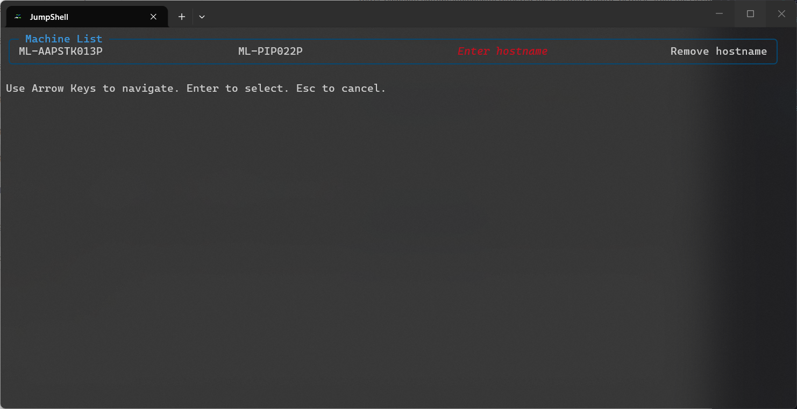
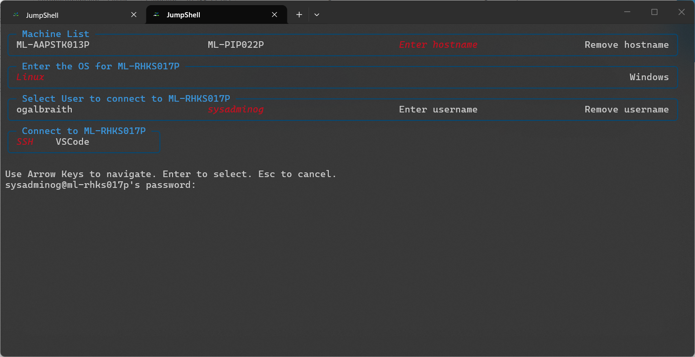

# JumpShell

JumpShell is a PowerShell-based remote connection launcher for Windows Terminal. It adds a dedicated `JumpShell` Windows Terminal profile and provides an interactive menu for connecting to remote Windows and Linux hosts using WinRM, SSH, or Visual Studio Code Remote SSH.

## Features

- Adds a `JumpShell` profile to Windows Terminal.
- Presents a configurable menu of saved remote hosts and users.
- Supports Windows remote connections via PowerShell Remoting (WinRM).
- Supports Linux remote connections via SSH and VS Code Remote SSH.
- Stores host and credential metadata in a YAML configuration file.
- Integrates with PasswordState for SSH keys and saved credentials.
- Automatically initializes configuration and required modules.

## Requirements

- Windows 10 / Windows 11
- Windows Terminal
- PowerShell (desktop edition)
- `powershell-yaml` PowerShell module
- `ConsoleFX` PowerShell module
- `LTF-PasswordState` PowerShell module
- Access to internal `LaTrobeRepo` PowerShell repository for module installation

## Installation

1. Clone the repository to your local machine.
2. Open PowerShell with administrative privileges if required for module install.
3. Run `setup.ps1` from the project root:

> Note: If the repo path or terminal config path differs, update `setup.ps1` accordingly.

The setup script will:

- Register the internal PowerShell repository `LaTrobeRepo` if it does not already exist.
- Install `powershell-yaml`, `ConsoleFX`, and `LTF-PasswordState`.
- Copy `src\jumpshell.ps1` to a profile-specific script file alongside your PowerShell profile.
- Add a `JumpShell` profile entry to Windows Terminal settings.

## Configuration

JumpShell stores its configuration in:

- `%APPDATA%\JumpShell\RemoteConnections-Config.yml`

The format includes:

- `configuration`: UI options, password storage settings, global SSH key references, and saved usernames.
- `connections`: saved remote hosts with operating system metadata and optional SSH key references.

You can edit this file directly or use the menu options within JumpShell to add/remove hosts and users. However, ensure the YAML structure is maintained if editing manually.

If you want to change the colours/options of the menu, you can modify the `configuration.menu_options` section in the YAML file.

The first run of `JumpShell` will create the default configuration file automatically.

## Usage

1. Open Windows Terminal and launch the `JumpShell` profile.
2. Use the menu to choose a host or enter a new hostname.
3. Select a user or add a new username.
4. For Linux hosts, choose between SSH and VS Code Remote SSH.

### Supported actions

- Add a new hostname.
- Remove an existing hostname.
- Add a new username.
- Remove an existing username.
- Connect to a Windows host with WinRM.
- Connect to a Linux host with SSH.
- Open a remote Linux host in VS Code using the Remote SSH extension.
- View and manage saved hosts and credentials in the configuration file.
- Automatically generate and manage SSH key pairs with PasswordState integration.
- Customise menu appearance and behaviour through configuration options.
- Set customised terminal colors for each host. (Currently has to be set manually in the config file)

### Screenshots

#### Menu

#### New Host

### Configuration File Options

| Option                                             | Description                                                                             | Options         | Default                                      |
| -------------------------------------------------- | --------------------------------------------------------------------------------------- | --------------- | -------------------------------------------- |
| `configuration`                                    | Global configuration settings for JumpShell.                                            |                 |                                              |
| `configuration.password_list`                      | The ID of the password list in PasswordState to use for storing/retrieving credentials. | `int`           | Will create a new list if not specified      |
| `configuration.global_ssh_keypair_id`              | The Password State ID of the global SSH keypair to use.                                 | `int`           | Will generate a new keypair if not specified |
| `configuration.seperate_ssh_key_pairs`             | Will generate separate SSH key pairs for each host.                                     | `bool`          | `false`                                      |
| `configuration.use_password_state`                 | Whether to use PasswordState for credential management.                                 | `bool`          | `true`                                       |
| `configuration.credentials:`                       | Credential settings for JumpShell.                                                      | `list[dict]`    |                                              |
| `configuration.credentials.username`               | The username for the saved credentials.                                                 | `string`        | `$env:USERNAME`                              |
| `configuration.credentials.password_id`            | The ID of the password in PasswordState.                                                | `int`           |                                              |
| `configuration.menu_options:`                      | Menu settings for JumpShell.                                                            | `dict`          |                                              |
| `configuration.menu_options.title_color`           | The color of the menu title.                                                            | `string|list`   | `cyan`                                       |
| `configuration.menu_options.columns`               | The number of columns in the menu.                                                      | `int`           | `6`                                          |
| `configuration.menu_options.clear_screen`          | Whether to clear the screen before displaying the menu.                                 | `bool`          | `false`                                      |
| `configuration.menu_options.border_color`          | The color of the menu border.                                                           | `string|list`   | `@(5, 72, 112)`                              |
| `configuration.menu_options.selection_color`       | The color of the selected menu item.                                                    | `string|list`   | `red`                                        |
| `connections`                                      | List of saved remote hosts with metadata.                                               | `list[dict]`    |                                              |
| `connections.<hostname>`                           | Configuration for a specific remote host.                                               | `dict`          |                                              |
| `connections.<hostname>.operating_system`          | The operating system of the remote host.                                                | `Windows|Linux` |                                              |
| `connections.<hostname>.public_key_set`            | A list of usernames where the public key authentication is set up for this host.        | `list[string]`  |                                              |
| `connections.<hostname>.terminal_color`            | Controls various terminal color settings for this host.                                 | `dict`          |                                              |
| `connections.<hostname>.terminal_color.background` | The background color of the terminal for this host.                                     | `string`        | Needs to be a valid hex color code.          |

---

## Notes

- The Windows Terminal profile is configured to launch PowerShell without loading the standard profile and then dot-source the JumpShell script.
- If the `JumpShell` profile already exists in Windows Terminal, setup will not duplicate it.
- When exiting from a WinRM session, the menu will not be displayed again due to how WinRM sessions are launched. You can relaunch the menu either by running the `Start-JumpShell` function or by opening a new `JumpShell` terminal.

## Troubleshooting

- If module installation fails, verify the repository URL and network access.
- If remote connections fail, confirm host reachability and credential configuration.
- For VS Code remote connections, ensure `code` is available in PATH and the Remote SSH extension is installed.

---